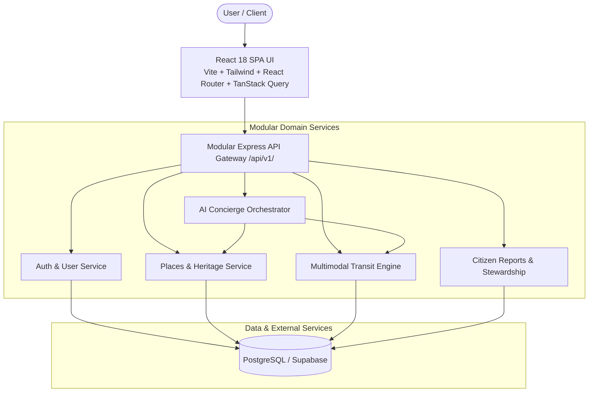

# Virasat architecture — current implementation and historical target

## Current audit: 2026-10-17

React/Vite calls /api/ai/chat (also mounted under /api/v1/ai/chat). The shared
TypeScript chat handler builds a minimal page context and bounded session history,
then calls modelGateway for Groq, OpenAI, local or compatible inference. Provider
tool requests pass through registry validation and authorization. Structured tourism
queries use the existing database repository (PostgreSQL when configured, JSON otherwise).
Narrative retrieval uses a source-traceable incremental index, lexical matching with
language term expansion, and optional cached embeddings with rank fusion.
Model output returns JSON or actual SSE deltas plus final structured data and sources.
AdvancedAIAssistant is reused by the AI page and global page launcher.

No FastAPI/SQLAlchemy service was present, and no duplicate inference backend was added.
Python is isolated to future training preparation/experiments. No model was trained.
See implementation-plan.md, feature-status.md and ai-platform-setup.md for actual
verification and remaining limitations. The sections below are historical target design,
not proof of deployed features; their old provider-free wording is superseded here.

> [!IMPORTANT]
> **TARGET ARCHITECTURE — NOT YET IMPLEMENTED**  
> This document specifies the planned target architecture for **Virasat** per Section XII of the **Master Product & Engineering Blueprint (V2)**.  
> **Current state**: Monolithic Express server (`server.ts`) with in-memory JSON state.  
> **Target state**: Modular Express backend with PostgreSQL (Supabase), TanStack Query, and React Router, built incrementally across Phases 1–8.

---

## Architecture Overview

---

## Architectural Tiers (Target Specification)

### 1. Client Layer (React Frontend)
- **Technology**: React 18, TypeScript, Vite, Tailwind CSS, `react-router-dom`, TanStack Query.
- **Role**:
  - Interactive map exploration (Leaflet) and 3D heritage previews (Three.js).
  - Component-driven architecture using standardized UI primitives (`components/ui/`).
  - URL-first navigation and state management via TanStack Query.

### 2. Application Layer (Modular Express Backend)
- **Technology**: Node.js, Express, TypeScript.
- **Role**:
  - Versioned API gateway (`/api/v1/`) with strict input schema validation (Zod).
  - Server-side session verification, role-based access control (RBAC), and rate limiting.
  - Domain-separated service modules (`server/src/modules/*`).

### 3. Persistence Layer (PostgreSQL / Supabase)
- **Technology**: PostgreSQL (managed via Supabase or local instance).
- **Role**:
  - Persistent storage for users, places, field-level provenance facts, itineraries, favorites, and citizen heritage reports.
  - Row Level Security (RLS) for multi-tenant data isolation.

### 4. AI Grounding & Orchestration Subsystem
- **Technology**: Virasat AI Astra local intent engine, app-data tools, and route logic; no hosted model dependency.
- **Role**:
  - Grounded travel assistant for the app's supported tourism domain.
  - Strict grounding against verified database records (tool calls to `searchPlaces`, `getTransport`, etc.).
  - Route supported requests through local data tools and return structured actions for app navigation.
